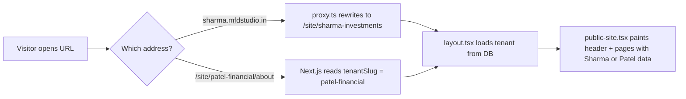

# MFD Studio — Manager & Architecture Guide (Layman Edition)

This document answers the questions your manager (or you) are likely to ask: **Do we need a separate backend?** **Can every MFD website look different?** **How are Payload, the database, and the frontend connected?** **How do we put each MFD on their own domain?**

It uses simple language. Technical terms are explained the first time they appear.

**Related doc:** [MFD_Studio_Guide.md](./MFD_Studio_Guide.md) — day-to-day operations, signup flow, security tests, and the original 24 FAQs.

---

## 1. Do I need a backend for this project?

### Short answer

**You already have a backend.** You do **not** need a second server (for example FastAPI, Django, or a separate Node API).

### What “backend” means here

A **backend** is the part of the system that:

- talks to the **database**;
- checks **who is logged in**;
- decides **who can see or change what**;
- saves **enquiries, pages, logos**, and business details.

In your project, that job is done by **Payload CMS**, running **inside the same Next.js app** on port 3000.

| Layer | What visitors / MFDs see | What it really is |
|--------|---------------------------|-------------------|
| Frontend | Marketing site, “Create website” wizard, MFD dashboard, public MFD websites | Next.js pages and React components under `src/app/(frontend)` and `src/components` |
| Backend (API + rules) | They don’t see it directly; they click Save and data appears | Payload: `/api/*`, `/admin`, custom `/api/mfd/*` routes |
| Database | Hidden | PostgreSQL (one database for all MFDs) |
| Files (logos) | Images on the website | `media` table + files in `/media` (move to S3 in production) |

### Do we need FastAPI or another Python backend?

**No**, for the product you have today:

- Signup, login, save website, enquiries, multi-tenant security → **Payload + `src/server/sites.ts`**
- Admin for you → **Payload `/admin`**
- Public websites → **Next.js** reading from Postgres via Payload

**When you might add Python later:** only for heavy jobs (for example parsing a CAS PDF, portfolio maths, a dedicated ML model). That would be a **small side service**, not a replacement for Payload. Payload would still own users, tenants, and permissions.

### One sentence for your manager

> “It’s one application: Next.js for screens, Payload for the API and database rules, PostgreSQL for storage. We are not running two backends.”

---

## 2. Can each website be dynamic, with a unique header and unique content?

### Short answer

**Yes — and it already works that way.**

Every public page is built from **that MFD’s row in the database**, not from one shared HTML file.

### What is “dynamic” here?

| Piece | Unique per MFD? | Where it comes from |
|--------|------------------|---------------------|
| Business name in the header | Yes | `tenants.name` |
| Logo or letter avatar | Yes | `tenants.logo` → `media` |
| Brand colour (buttons, accents) | Yes | `tenants.primary_colour` |
| Font style (Modern / Classic / …) | Yes | `tenants.font_style` → CSS in `src/lib/themes.ts` |
| Menu links (Home, About, custom pages) | Yes | `pages` rows for that `tenant_id` |
| Page text (About, Services, custom “NRI” page) | Yes | `pages.title`, `summary`, `body` |
| Top announcement banner | Yes | `tenants.announcement` |
| Services cards | Yes | `services` table |
| Contact details, ARN in footer | Yes | `tenants` fields |
| SEO title in Google | Yes | `pages.seo_title`, `seo_description` |

The **layout** (where the header sits, how the menu looks) is **one shared template** in code (`src/components/website/public-site.tsx`). The **content and branding** inside that template change per MFD.

That is normal for SaaS: same safe structure, different data — like every shop on Shopify sharing a theme engine but different logos and text.

### How a visitor gets Sharma’s site vs Patel’s site



### “I want totally different headers per MFD” (design freedom)

**Possible.** Today everyone uses one header component. To offer **Template A / Template B**:

1. Add a field on the tenant, for example `headerStyle: 'classic' | 'minimal'`.
2. In `public-site.tsx`, switch which header component to render based on that field.
3. MFD picks the style in the dashboard (Branding screen).

**Even more freedom (page builder):** store **blocks** on each page in Payload (hero, FAQ, testimonial, video). Each block is a small React piece. That is how Webflow-style builders work on top of a CMS — more work, but very flexible.

### “I want unique content” — who edits it?

- **MFD** → `/dashboard` (friendly editor, autosave to `PUT /api/mfd/site`).
- **You (support)** → `/admin` → pick “MFD business” → edit Pages, Tenants, etc.
- **Visitors** → only see **published** content; drafts stay hidden.

---

## 3. How Payload, the database, and the frontend are connected

Think of three layers plugged together:

```mermaid
flowchart TB
  subgraph browser [Browser]
    D[Dashboard UI]
    P[Public website HTML]
  end
  subgraph next [Next.js on port 3000]
    R[Routes: /dashboard, /site/...]
    API[Payload APIs: /api/mfd/*, /api/users/*]
    ADM[/admin]
  end
  subgraph payload [Payload CMS core]
    COL[Collections = table definitions]
    ACC[Access rules + multi-tenant plugin]
    LOC[Local API: create/find/update]
  end
  DB[(PostgreSQL)]

  D -->|fetch /api/mfd/me, PUT /api/mfd/site| API
  P -->|Server render: getPayload + loadSite| LOC
  API --> ACC --> LOC --> DB
  ADM --> ACC
  COL -.->|defines schema| DB
```

**Connection string:** `.env` → `DATABASE_URL=postgresql://...` → `postgresAdapter` in `src/payload.config.ts`.

**Secret for cookies:** `PAYLOAD_SECRET` in `.env`.

**Public domain for subdomains:** `NEXT_PUBLIC_ROOT_DOMAIN=localhost:3000` (production: `mfdstudio.in` or your real domain).

---

## 4. Complete file map (what each important file does)

This is the “wiring diagram” in filenames.

### 4.1 Configuration and environment

| File | Layman explanation |
|------|---------------------|
| `.env` | Passwords and URLs for **your machine only** (database URL, Payload secret, root domain). Never commit real secrets to git. |
| `.env.example` | Template showing which variables teammates need. |
| `package.json` | Lists dependencies (Next.js, Payload, Postgres adapter) and scripts (`pnpm dev`, `generate:types`). |
| `docker-compose.yml` | Optional: starts PostgreSQL in a container if you don’t install Postgres locally. |
| `src/payload.config.ts` | **Brain of the backend:** which tables exist, multi-tenant plugin, Postgres connection, custom API routes. |

### 4.2 Database tables (collections)

Each file under `src/collections/` describes **one table** (columns, validation, who can read/write).

| File | Table(s) | One row means |
|------|----------|----------------|
| `tenants.ts` | `tenants`, `tenants_faqs`, `tenants_team` | One MFD business: name, slug, ARN, colours, font, plan, domain, published flag, FAQs, team |
| `Users.ts` | `users`, `users_roles`, `users_tenants`, `users_tenants_roles` | One login; which tenant(s) they belong to |
| `Pages.ts` | `pages` | One page on an MFD website (home, about, or custom) |
| `Services.ts` | `services` | One service card |
| `Achievements.ts` | `achievements` | One achievement / milestone |
| `Articles.ts` | `articles` | One learn/blog article |
| `Leads.ts` | `leads` | One visitor enquiry (private) |
| `Media.ts` | `media` | One uploaded image file |

`src/access.ts` — shared rules: super-admin, signed-in user, public read.

`src/payload-types.ts` — auto-generated TypeScript types from the schema (run `pnpm generate:types` after schema changes).

### 4.3 Business logic (create site, save site, load site)

| File | Layman explanation |
|------|---------------------|
| `src/server/sites.ts` | **Most important logic file.** `createSite` = new MFD signup. `saveSite` = dashboard autosave. `loadSite` = read one MFD’s full website. `findPublicTenantId` = match slug or verified domain. |
| `src/endpoints/mfd.ts` | HTTP doors: `GET /api/mfd/me`, `POST /api/mfd/signup`, `PUT /api/mfd/site`, `POST /api/mfd/sites/:site/enquiries`. Wraps signup/save in a **database transaction** (all or nothing). |
| `src/lib/build-tenant.ts` | Default pages and content for a **brand-new** website; `slugify` for URLs. |
| `src/lib/sample-data.ts` | TypeScript shapes the UI expects (`Tenant`, `SitePage`, `Lead`, …). |
| `src/lib/themes.ts` | Font presets and colour helpers. |
| `src/lib/plans.ts` | Essential / Growth / Pro limits (page counts, etc.). |

### 4.4 Frontend — marketing, dashboard, public sites

| File | Layman explanation |
|------|---------------------|
| `src/app/(frontend)/layout.tsx` | Loads fonts globally for all sites. |
| `src/app/(frontend)/(flow)/create/page.tsx` | “Create website” wizard page. |
| `src/components/flow/create-website.tsx` | Steps of the wizard; calls signup API; shows final URLs. |
| `src/components/prototype/store.tsx` | **Dashboard brain in the browser:** login, load tenant, debounced autosave to `PUT /api/mfd/site`, add pages/services. |
| `src/components/dashboard/*.tsx` | Dashboard screens (branding, pages, leads, domain, …). |
| `src/app/(frontend)/site/[tenantSlug]/layout.tsx` | **Public site loader:** on the server, loads published tenant data and wraps children in `PublicTenantProvider`. |
| `src/app/(frontend)/site/[tenantSlug]/**/page.tsx` | One route per built-in page (about, contact, …) plus `[pageSlug]` for custom pages. |
| `src/components/website/public-site.tsx` | Renders header, nav, pages, contact form — using `tenant` from context. |
| `src/proxy.ts` | Maps `sharma.yourdomain.com` → internal path `/site/sharma-investments`. |

### 4.5 Payload admin (your back office)

| URL | Who uses it |
|-----|-------------|
| `http://localhost:3000/admin` | **You** (super-admin): all tenants, verify domains, change plans, support edits. |
| `http://localhost:3000/dashboard` | **Each MFD**: only their business. |

---

## 5. Database tables explained (layman + technical)

### 5.1 Core idea

- **One PostgreSQL database** for the whole platform.
- **One new MFD** = new rows in existing tables, **not** new tables.
- Almost every content row has **`tenant_id`** (or `tenant`) = “this belongs to Sharma” or “this belongs to Patel”.

### 5.2 Table reference

| Table | What it stores | Key columns (simplified) | Tenant? |
|-------|----------------|---------------------------|---------|
| `tenants` | The MFD business itself | `name`, `slug` (unique), `arn`, `primary_colour`, `font_style`, `plan`, `status`, `allow_public_read`, `domain`, `domain_status`, `announcement`, … | N/A (this *is* the tenant) |
| `tenants_faqs` | FAQ Q&A list on the site | `question`, `answer` | Parent = one tenant |
| `tenants_team` | Team members | `name`, `role`, `euin`, `member_slug` | Parent = one tenant |
| `users` | Login accounts | `email`, `password` (hash), `name`, `roles` | Linked via join table |
| `users_tenants` | “User X works for tenant Y” | `parent_id` → user, `tenant_id` | Yes |
| `users_tenants_roles` | Admin vs viewer on that tenant | `value` = `tenant-admin` / `tenant-viewer` | Yes |
| `users_roles` | Platform role | `super-admin` or `user` | — |
| `pages` | Website pages | `slug`, `title`, `path`, `body`, `status`, `locked`, `custom`, `seo_title`, `tenant_id` | Yes |
| `services` | Service cards | `key`, `title`, `description`, `status`, `sort_order`, `tenant_id` | Yes |
| `achievements` | Milestones | `key`, `title`, `year`, `status`, `tenant_id` | Yes |
| `articles` | Education posts | `slug`, `title`, `body`, `status`, `tenant_id` | Yes |
| `leads` | Enquiries | `name`, `email`, `message`, `status`, `source`, `tenant_id` | Yes (private) |
| `media` | Files | `filename`, `url`, `mime_type`, `tenant_id` | Yes |
| `payload_*` | Migrations, preferences, locks | Internal Payload housekeeping | — |

### 5.3 Example: two MFDs, same table

| id | tenant_id | slug | title |
|----|-----------|------|-------|
| 1 | 4 | home | Home |
| 2 | 4 | about | About Sharma |
| 9 | 5 | home | Home |
| 10 | 5 | about | About Patel |

When Sharma’s dashboard asks for pages, the server only returns rows where `tenant_id = 4`.

### 5.4 When are tables created?

- **Development:** Payload **pushes** schema from collection files to Postgres when the app starts (you may see “Pulling schema…” in the terminal).
- **Production:** use **migrations** (`payload migrate`) so changes are controlled and safe.

---

## 6. End-to-end flows (step by step)

### 6.1 New MFD signs up (“Create website”)

1. Browser: `POST /api/mfd/signup` with form data + password (`create-website.tsx` → `store.tsx`).
2. `src/endpoints/mfd.ts` starts a **transaction**.
3. `createSite()` in `src/server/sites.ts`:
   - Inserts **`tenants`** (slug from business name).
   - Creates **`users`** + **`users_tenants`** (owner is `tenant-admin`).
   - Inserts starter **`pages`**, **`services`**, **`achievements`**, **`articles`**, optional **`media`** (logo), sample **`leads`**.
4. Transaction **commits** → browser logs in via `/api/users/login` → shows URLs.

### 6.2 MFD edits branding in dashboard

1. User types in dashboard → `store.tsx` updates local state → after 700 ms quiet, `PUT /api/mfd/site` with full tenant JSON.
2. Server reads **tenant ID from logged-in user**, not from the request body (`tenantIdOf(user)`).
3. `saveSite()` updates `tenants`, syncs `pages` / `services` / etc.
4. Public site on next refresh shows new header colour, announcement, etc.

### 6.3 Visitor opens public website

1. URL hits `proxy.ts` (subdomain/custom domain) or goes straight to `/site/[tenantSlug]/...`.
2. `layout.tsx` calls `getPayload()` → `findPublicTenantId` → `loadSite(..., includePrivate: false)`.
3. Only **published** pages/services; site must be **published** (`allow_public_read`) and not **suspended**.
4. HTML sent to browser with Sharma’s name, logo, colours in the header.

### 6.4 Visitor sends enquiry

1. `POST /api/mfd/sites/sharma-investments/enquiries` (from contact form).
2. Server resolves tenant from **slug or verified domain** — visitor is not logged in.
3. New row in **`leads`** with that `tenant_id`.
4. Only that MFD sees it in Dashboard → Leads.

---

## 7. Deploying each MFD on a separate domain

### 7.1 Important clarification for managers

**You usually do NOT deploy a separate server per MFD.**

You deploy **one** MFD Studio application. **Many domains** point to that same app. The app looks at the **hostname** (or path) and loads the right tenant from the database.

| Model | What it means | When to use |
|--------|----------------|-------------|
| **Multi-tenant SaaS (your project)** | One app, one database, many domains/subdomains | Standard for hundreds of MFDs; cheap to run and update |
| **Separate deploy per MFD** | Each MFD gets their own server and database | Rare; only for enterprise contracts or regulatory isolation |

Your code is built for the **first** model.

### 7.2 Three URL styles (all can work at once)

| Style | Example | Who configures |
|--------|---------|----------------|
| Path on your platform | `https://mfdstudio.in/site/sharma-investments` | Automatic at signup |
| Subdomain on your platform | `https://sharma-investments.mfdstudio.in` | DNS: `*.mfdstudio.in` → your host; `NEXT_PUBLIC_ROOT_DOMAIN=mfdstudio.in` |
| MFD’s own domain | `https://www.sharmainvestments.in` | MFD adds CNAME; **you** set `domain` + verify in `/admin` |

### 7.3 Steps to go live with custom domains (production)

1. **Host the app** (Vercel, Railway, AWS, DigitalOcean, etc.) with PostgreSQL and env vars: `DATABASE_URL`, `PAYLOAD_SECRET`, `NEXT_PUBLIC_ROOT_DOMAIN=mfdstudio.in`.
2. **Wildcard DNS:** `*.mfdstudio.in` → hosting provider (for subdomains).
3. **HTTPS:** platform wildcard certificate + per-custom-domain certificates (Vercel/Cloudflare for SaaS/Caddy on VPS).
4. **MFD flow:** Dashboard → Domain → enter `www.theirdomain.com` → status `pending`.
5. **MFD at registrar:** CNAME `www` → value you show (often your platform hostname).
6. **You:** DNS lookup confirms → `/admin` → Tenant → **Domain status = verified**.
7. `proxy.ts` routes `www.theirdomain.com` to `/site/www.theirdomain.com`; `findPublicTenantId` matches `tenants.domain` when verified.

### 7.4 If a manager asks: “Can we host Sharma on AWS and Patel on Azure?”

**Technically yes, but that is a different product architecture** (separate databases, separate deploys, no shared multi-tenant plugin benefits). Your current codebase assumes **one platform, many tenants**. Say: “We can white-label one platform; separate infra per MFD is a custom enterprise option with higher cost.”

---

## 8. Cross-questions your manager might ask (with answers)

Use these in meetings. Answers are honest for **this** codebase.

### Strategy and product

| Question | Answer |
|----------|--------|
| Is this a website builder or a CMS? | **Both, in practice:** Payload is the CMS (content + rules); Next.js is the website renderer and MFD dashboard. MFDs don’t drag arbitrary HTML — they edit safe fields and pages. |
| How fast can we onboard a new MFD? | **Minutes:** they complete the wizard; tenant + site + login exist in one transaction. |
| Can we scale to 1,000 MFDs? | **Yes** on one app + one Postgres, with proper hosting, indexes, backups, and CDN for media. |
| What is our moat vs a generic website? | Compliance-aware defaults (ARN, disclosures, blocked phrases), MFD-specific dashboard, leads inbox, plan limits, AMFI-oriented templates. |

### Technology

| Question | Answer |
|----------|--------|
| Do we need a separate backend team for FastAPI? | **No.** Backend is TypeScript/Payload in this repo. Python only if we add specialised analytics later. |
| Why PostgreSQL? | Reliable, fits Payload’s official adapter, good for relational multi-tenant data and reporting. |
| Is data isolated between MFDs? | **Yes** — tenant ID on rows, access rules, plugin filters, custom endpoints never trust tenant ID from the browser. Tested with two demo tenants. |
| What if Postgres goes down? | Entire platform pauses (signups, saves, public sites). Mitigation: managed DB, replicas, backups, monitoring. |
| Where are passwords stored? | Hashed by Payload; plain passwords are never stored. |

### Security and compliance

| Question | Answer |
|----------|--------|
| Can an MFD see another MFD’s leads? | **No**, if access rules stay as implemented. |
| Can an MFD upgrade themselves to Pro without paying? | **No** — plan field is super-admin only. |
| Can someone fake a custom domain? | **Not publicly** — site only serves on custom domain when **you** set domain status to verified. |
| GDPR / consent on contact forms? | Consent timestamp can be stored on leads (`consentAt`); legal wording and DPA need lawyer review before production. |
| Who can access `/admin`? | Super-admins only (platform owner). MFDs use `/dashboard`. |

### Operations and cost

| Question | Answer |
|----------|--------|
| Cost per new MFD? | **Marginal:** a few hundred DB rows, not a new server. Main costs are hosting, storage, email, support. |
| How do we backup? | `pg_dump` + copy media/S3 bucket; test restore quarterly. |
| How do we delete an MFD? | Delete tenant in `/admin` (and related rows per cascade rules) or soft-delete via `status = suspended` first. |
| Deploy frequency? | One deploy updates **all** MFD sites at once — feature flags help for risky changes. |

### Sales and support

| Question | Answer |
|----------|--------|
| Can the MFD use their own domain? | **Yes**, after DNS + your verification. |
| Can they add pages without calling us? | **Yes** — Dashboard → Pages → Add page (within plan limit). |
| Can they change fonts and colours? | **Yes** — four font presets + any brand colour. |
| What still needs us manually? | Domain verification, plan changes, suspensions, content support via `/admin`, legal/compliance review. |
| What is still demo data? | Visitor chart, fund NAV list, AI wallet/billing — not connected to live providers yet. |

### Tough “gotcha” questions

| Question | Answer |
|----------|--------|
| Why not WordPress per client? | Hard to run hundreds of installs, updates, and security patches; multi-tenant SaaS is one codebase, one security model. |
| Why not Wix for each MFD? | Less control over compliance, leads, and your product roadmap; you want everything in **your** database. |
| Single point of failure? | One app + one DB — mitigate with HA database, multiple app instances, backups, status page. |
| Can a developer steal all leads with DB access? | Anyone with **database credentials** can read everything — restrict DB access, audit logs, encryption at rest; app-level isolation protects **MFD users from each other**, not rogue DB admins. |
| Migration from prototype localStorage? | Already done for this project — data lives in Postgres via Payload. |

---

## 9. Quick checklist before you demo to management

1. PostgreSQL running; `.env` filled in.
2. `pnpm dev` → `http://localhost:3000`.
3. Create a test MFD → note **path URL** and **subdomain URL**.
4. Edit announcement in dashboard → refresh public site.
5. Submit enquiry → see lead in dashboard.
6. Open `/admin` as super-admin → show tenant row and isolation.
7. Explain: **one deploy, many domains**, Payload = backend, no FastAPI required.

---

## 10. Glossary (30 seconds)

| Term | Meaning |
|------|---------|
| **Tenant** | One MFD business on the platform |
| **Slug** | URL-safe short name (`sharma-investments`) |
| **Payload** | Headless CMS + API + admin inside Next.js |
| **Collection** | A table definition in code |
| **Multi-tenant** | Many customers share one app; data separated by `tenant_id` |
| **Headless CMS** | Content in DB + API; your Next.js app controls the design |
| **Transaction** | All DB steps succeed together or roll back (no half-created website) |
| **SSR** | Server builds HTML before sending to browser (good for SEO) |

---

*Last updated for the MFD Studio codebase: Next.js + Payload 3 + PostgreSQL multi-tenant plugin, custom `/api/mfd/*` endpoints, and `src/proxy.ts` domain routing.*
