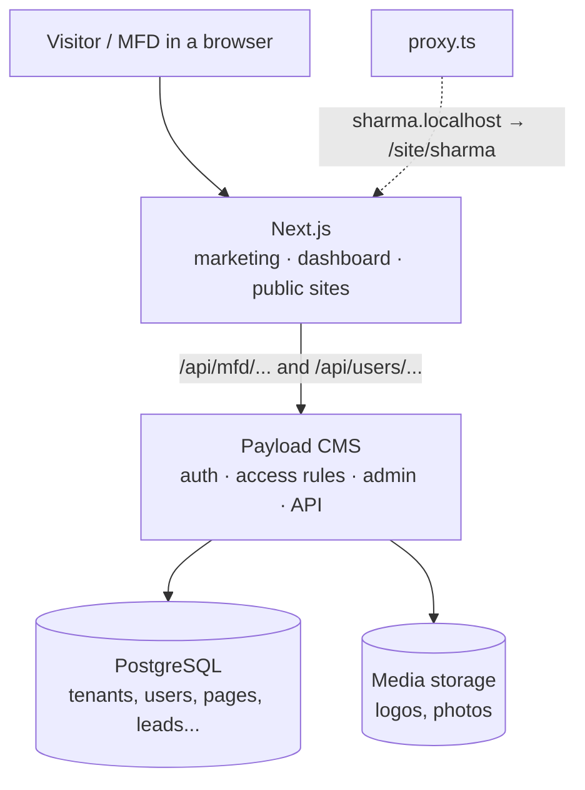
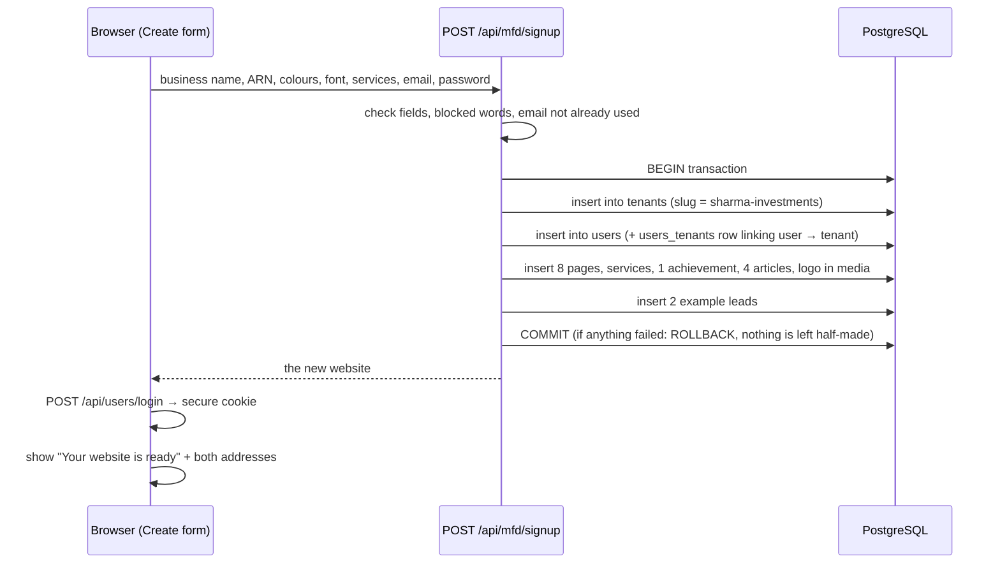

# MFD Studio — The Plain-English Guide

This guide explains how **your** project works now: what each part does, what happens when an MFD (Mutual Fund Distributor) creates a website, how their web address is made, what you manage in Payload, and whether you need FastAPI.

It is written for someone who is not a backend expert. Technical words are explained the first time they appear.

**Also read:** [MFD_Manager_and_Architecture_Guide.md](./MFD_Manager_and_Architecture_Guide.md) — backend vs frontend, dynamic unique sites, full file map, database tables, per-domain deployment, and **manager cross-question FAQs**.

---

## 0. The 30-second summary

- **Your app is one Next.js project with Payload CMS inside it, connected to one PostgreSQL database.** No second backend is needed.
- When an MFD fills the **Create website** form, the server creates, in one go: a **tenant** (their business), a **user** (their login), and starter **pages, services, articles and example enquiries**. All of these rows carry that tenant's ID.
- The MFD immediately gets **two working addresses**:
  - `http://localhost:3000/site/sharma-investments` (path address)
  - `http://sharma-investments.localhost:3000` (subdomain address)
  - Later: `www.sharmainvestments.in` (their own domain, after verification)
- The dashboard saves changes to the database automatically, about 0.7 seconds after the MFD stops typing. The header shows **"Saving…" → "All changes saved"**.
- One MFD can never see or change another MFD's data. This was tested; see section 9.

---

## 1. What I found when I analysed your UI

Your screens were already well designed. The problem was that **nothing was saved anywhere real**: everything lived in the browser's temporary memory (`sessionStorage`). Close the tab, and the website was gone. Open the link on your phone, and it said "not available".

### What is good about the design

| Area | Why it works |
|---|---|
| Home page hero | Clear promise ("Your AI front office for your MFD business"), trust line (AMFI registration ready), a live-looking preview card. |
| Create flow | Short steps (Plan → You → Business → Look → Services → Contact → Your link). Low effort, high completion. |
| Compliance thinking | ARN on every page, a locked Disclosures page, blocked words like "guaranteed returns", achievements need confirmation. This is a real selling point for MFDs. |
| Dashboard | Grouped sidebar (Practice, Website, Enquiries, Growth, Account), plan-based "Upgrade" badges, phone/desktop preview. |
| Public site | Clean, brand-coloured, mobile friendly, always shows the market-risk line. |

### Small improvements to consider (not done, your choice)

1. **Two competing main buttons.** The header says *Create website*, while the hero's main button says *Book a discovery call*. Pick one main action per screen. Since the product is self-serve, *Create website* is the stronger choice.
2. **The "AUI + 8k · Illustrative" badge** next to the hero buttons is unclear to a first-time visitor. Either explain it or remove it.
3. **Sample numbers.** The visitors chart and the fund list (NAV) are still sample data. They are labelled, but plan to connect real analytics and a licensed NAV source before launch.
4. **Sidebar length.** 20 items is a lot for a new MFD. Consider hiding locked (Upgrade) items behind one "More tools" entry.

### What I changed so that "everything works"

| Before | Now |
|---|---|
| Website stored in the browser tab only | Stored in PostgreSQL through Payload |
| Login accepted any email | Real login with email + password (Payload auth, secure cookie) |
| Signup "password is not stored" | Password is hashed and stored by Payload |
| Public link only worked in the same browser | Works on any device, any browser |
| Enquiry form only pretended to save | Saved as a real lead, visible only to that MFD |
| Logo/photo kept as text in the browser | Uploaded to the **Media** collection (files in `/media`) |
| One address style | Path address + subdomain address + custom domain support |
| Fixed pages, one font | MFD can add extra pages and choose from 4 font styles |

---

## 2. The big picture (your diagram, explained)

Think of the platform as a **hotel**:

| Hotel | Your platform | Where it is in code |
|---|---|---|
| Reception and rooms guests see | **Next.js** — marketing pages, MFD dashboard, every public MFD website | `src/app/(frontend)` |
| The back office that runs the hotel | **Payload CMS** — admin panel, login, rules about who can see what, the API | `src/payload.config.ts`, `src/collections`, `src/endpoints` |
| The filing cabinet | **PostgreSQL** — stores every business, page, lead | `DATABASE_URL` in `.env` |
| The storeroom | **Object storage** — logos, photos | currently the `/media` folder; later S3 |
| A guest's room number | **Tenant ID** — the label on every record that says "this belongs to Sharma Investments" | `tenant` field on each record |



Next.js and Payload are **the same program** running on port 3000. Payload is not a separate server; it lives inside Next.js.

---

## 3. What is the role of Payload CMS?

"CMS" means **Content Management System**: software that stores content and gives you a place to manage it.

In your project Payload does six jobs:

1. **Defines your database tables.** You describe a "collection" in TypeScript (for example `src/collections/Leads.ts`) and Payload creates the matching PostgreSQL table and columns for you. You never write `CREATE TABLE` by hand.
2. **Login and passwords.** The `users` collection has `auth: true`, so Payload hashes passwords, issues the login cookie, and offers login, logout, forgot-password and reset-password endpoints.
3. **Rules about who can see what (access control).** Every collection has `access` rules. For example: *only a super-admin can delete a tenant*, and *a visitor cannot read leads*.
4. **Multi-tenancy (keeping MFDs separate).** The official `@payloadcms/plugin-multi-tenant` adds a `tenant` field to pages, services, achievements, articles, leads and media. It automatically filters every query to the user's own tenant.
5. **The API.** Every collection automatically gets REST endpoints (`/api/pages`, `/api/leads`, …). You also wrote custom endpoints for the special flows (`/api/mfd/signup` and others).
6. **The admin panel at `/admin`.** This is **your** back office as the platform owner. You see all MFDs, change plans, verify domains, suspend accounts, and fix content.

> **Two different "offices":**
> - **`/dashboard`**: the friendly office for each MFD. It shows only their own business.
> - **`/admin`**: the Payload admin, for you (super-admin) only. MFD accounts are blocked from it.

---

## 4. What happens when someone creates a new MFD website?

### 4.1 The journey, step by step



The code is in `src/server/sites.ts`, function `createSite`, and `src/endpoints/mfd.ts`.

### 4.2 "How are the tables and the tenant created?"

**Important idea:** a new MFD does **not** get new tables or a new database. All MFDs share the same tables. Each **row** carries a `tenant_id` saying who owns it.

It works like one big register book where every line starts with the business name.

| `pages` table | | | |
|---|---|---|---|
| **id** | **tenant_id** | **slug** | **title** |
| 1 | 4 (Sharma) | home | Home |
| 2 | 4 (Sharma) | about | About |
| 10 | 5 (Patel) | home | Home |

When Sharma's dashboard asks for pages, the server only returns rows where `tenant_id = 4`.

**When are the tables themselves created?** When the app starts in development, Payload compares your collection files to the database and adds anything missing (this is called **push** mode). You saw this as *"Pulling schema from database…"* in the terminal. For production you use **migrations** instead (section 11).

### 4.3 Tables in your database right now

| Table | One row means | Belongs to a tenant? |
|---|---|---|
| `tenants` | One MFD business: name, slug, ARN, colours, font, plan, domain, published flag | It *is* the tenant |
| `tenants_faqs`, `tenants_team` | Approved FAQ answers, team members (list fields on the tenant) | Yes, through the tenant |
| `users` | One person who can log in (password stored as a hash) | Linked via `users_tenants` |
| `users_tenants`, `users_tenants_roles` | "User 4 is admin of tenant 4": the membership | Yes |
| `users_roles` | `super-admin` or `user` | — |
| `pages` | One website page (home, about, custom pages…) | Yes (`tenant_id`) |
| `services` | One service card | Yes |
| `achievements` | One milestone (published only after confirmation) | Yes |
| `articles` | One investor-education note | Yes |
| `leads` | One enquiry from a visitor (private) | Yes |
| `media` | One uploaded logo/photo (file is in `/media`) | Yes |
| `payload_*` | Payload's own bookkeeping (preferences, locks, migrations) | — |

### 4.4 Who decides the tenant ID?

**Always the server, never the browser.** This is the golden rule.

- **Signup:** the server creates the tenant, gets its new ID, and links the new user to it.
- **Dashboard save** (`PUT /api/mfd/site`): the server reads the tenant from the **logged-in user's membership**. Even if someone edits the request in their browser, they cannot write into another tenant.
- **Enquiry form** (`POST /api/mfd/sites/:site/enquiries`): the visitor is not logged in. The server looks up the tenant from the **website address** (slug or verified domain), and only if that site is published.

---

## 5. How is the URL of a new MFD website created?

### 5.1 The slug

The **slug** is the web-friendly version of the business name:

```
"Sharma Investments"  →  sharma-investments
"Patel & Sons Pvt."   →  patel-sons-pvt
```

`slugify()` in `src/lib/build-tenant.ts` does this: lowercase, letters and numbers only, spaces become `-`. If the slug is already taken, the server adds a number (`sharma-investments-2`). Words like `admin`, `api`, `www` and `dashboard` are reserved. The slug is stored in `tenants.slug`, which is **unique**, and only a super-admin can change it later, because changing it would break links the MFD has already shared.

### 5.2 Three ways to reach the same website

| Address | Example | How it works |
|---|---|---|
| Path | `localhost:3000/site/sharma-investments` | The Next.js folder `src/app/(frontend)/site/[tenantSlug]/` treats the slug as a parameter. |
| Subdomain | `sharma-investments.localhost:3000` | `src/proxy.ts` reads the host name, takes the part before your root domain, and quietly rewrites the request to `/site/sharma-investments`. |
| Custom domain | `www.sharmainvestments.in` | Same proxy. Any unknown host is rewritten to `/site/www.sharmainvestments.in`. The server only shows a site if `tenants.domain` matches **and** `domainStatus = verified`. |

The root domain is set by `NEXT_PUBLIC_ROOT_DOMAIN` in `.env` (`localhost:3000` today; `mfdstudio.in` or similar in production).

> **Tip:** Chrome and Edge understand `anything.localhost` automatically, so subdomain addresses work on your computer with no setup.

### 5.3 How the public page finds the right MFD

1. A visitor opens `sharma-investments.localhost:3000/about`.
2. `proxy.ts` rewrites it to `/site/sharma-investments/about`.
3. `site/[tenantSlug]/layout.tsx` runs **on the server**. It calls Payload to find the tenant, checks it is published and not suspended, and loads only **published** pages, services and achievements (never leads).
4. The page is sent as finished HTML, which is good for Google, with the MFD's colour, font, logo and SEO title.

### 5.4 Custom domain process (what the MFD does, what you do)

1. The MFD opens **Dashboard → Domain**, types `www.sharmainvestments.in`, and clicks **Save domain**. The status becomes *Waiting for DNS check* (`pending`).
2. The MFD adds the shown **CNAME** record at their domain provider (GoDaddy, Hostinger…).
3. **You** check that the record exists (for example with `nslookup www.sharmainvestments.in`), then in `/admin → Tenants → Sharma` set **Domain status = Verified**.
4. Your hosting must also accept that domain and issue HTTPS for it (section 11).

An MFD cannot mark their own domain as verified; the field is super-admin-only. This prevents someone from claiming a domain they don't own.

---

## 6. What do you (the platform owner) handle in Payload?

Open `http://localhost:3000/admin` and log in with your super-admin account (`hsamala@llamaworx.com`).

| Task | Where in /admin | Notes |
|---|---|---|
| See every MFD | Collections → **Tenants** | Columns: name, slug, plan, status, published. |
| Change a plan after payment | Tenant → sidebar → **Plan** | MFDs cannot change their own plan. Page limits and AI features follow it. |
| Suspend a non-paying MFD | Tenant → **Status = Suspended** | Their public site shows "not available" instantly. |
| Verify a custom domain | Tenant → **Domain status = Verified** | Only after checking DNS. |
| Help an MFD fix content | **Pages / Services / Achievements / Articles** | Use the "MFD business" selector at the top to switch tenant. |
| Look at enquiries for support | **Leads** | Treat as private data; access only when needed. |
| Reset someone's access | **Users** | Edit email, set a new password, or change tenant membership. |
| Remove junk/test data | Any collection → select → Delete | Example: the old tenant with slug `slug` (domain `voice.abc.com`) from earlier experiments, and the two test MFDs from my testing. |

### What the code already handles for you (no daily work needed)

- Creating tables and columns (push in dev, migrations in production).
- Password hashing, login cookies, session expiry.
- Filtering every REST and admin query to the right tenant (multi-tenant plugin).
- Blocking MFDs from `/admin`, from other tenants, and from changing plan, status, slug or domain verification.
- Rolling back half-finished signups.

---

## 7. Do I need a FastAPI backend?

**No, not for this product today.**

Payload already gives you everything a FastAPI backend would provide here: database models, login, permissions, an API, file uploads and an admin panel. Adding FastAPI would mean:

- two codebases, two deployments, two sets of bugs;
- writing the user and permission logic **twice** (once in Payload, once in Python);
- the risk that the two disagree about who can see what, which is the most dangerous kind of bug in a multi-tenant system.

**When FastAPI *could* make sense later:**

| Situation | Better approach |
|---|---|
| Heavy number-crunching in Python (portfolio analytics, CAS statement parsing, ML) | A small Python **worker service** that Payload calls. It holds no user data of its own. |
| Your team is mainly Python developers | Still keep Payload as the source of truth; Python only for specific jobs. |
| AI assistant | Can be done in TypeScript (OpenAI/Anthropic SDKs) inside a Payload endpoint. |

The older document `MFD_Platform_Implementation_Guide.md` (Part 1) suggests FastAPI. That was a general recommendation written before Payload was chosen. **For this codebase, follow this guide.**

---

## 8. Making every website flexible (extra pages, fonts, colours…)

### 8.1 What an MFD can already change (no developer needed)

| Want | Where | Stored in |
|---|---|---|
| Brand colour (6 presets or any hex colour) | Branding / Create step 4 | `tenants.primary_colour` |
| **Font style**: Modern, Classic (serif), Friendly (rounded), Simple | Branding / Create step 4 | `tenants.font_style` |
| Logo and profile photo | Branding | `media` + `tenants.logo_id` / `photo_id` |
| **Add an extra page** (for example "NRI investing", "Tax saving") | Dashboard → Pages → *Add page* | `pages` row with `custom = true` |
| Delete a custom page | Pages → *Delete page* | removed row |
| Publish / unpublish any page | Pages | `pages.status` |
| Add, reorder, remove services | Services | `services` rows with `sort_order` |
| Add/remove achievements | Achievements | `achievements` |
| Top-of-site announcement banner | Announcements | `tenants.announcement` |
| SEO title & description | SEO / Pages | `pages.seo_title`, `seo_description` |
| Own domain | Domain | `tenants.domain` |

Custom pages appear in the site menu automatically and open at `/site/<slug>/<page>`. They are counted against the plan's page limit (Essential 8, Growth 15, Pro 25).

### 8.2 How the font switch works (so you can add more)

1. The fonts are loaded once in `src/app/(frontend)/layout.tsx` using `next/font` (Inter, Plus Jakarta Sans, Lora, Poppins).
2. `fontPresets` in `src/lib/themes.ts` lists which font is used for headings and body text.
3. The public site wraps itself in `fontStyleVars(tenant.fontStyle)`, which swaps the CSS variables, so every heading changes at once.

**To add a new font** (for example "Elegant" using Playfair Display):

1. In `layout.tsx`: `const playfair = Playfair_Display({ subsets: ["latin"], variable: "--font-playfair" })`, and add `playfair.variable` to the `<html>` className.
2. In `themes.ts`: add `{ id: "elegant", name: "Elegant", heading: "var(--font-playfair)", body: "var(--font-inter)" }`.
3. In `src/collections/tenants.ts`: add `{ label: 'Elegant', value: 'elegant' }` to the `fontStyle` options.
4. Restart `pnpm dev` (the database column updates itself) and run `pnpm generate:types`.

### 8.3 Ideas for more flexibility later (and how)

| Idea | How to build it |
|---|---|
| **Section blocks** (hero, testimonials, FAQ, video, map) that MFDs arrange per page | Add a Payload `blocks` field to `Pages`. Each block type is a small React component on the public site. |
| **Multiple templates/layouts** ("Classic", "Bold", "Minimal") | Add `template` select on `tenants`; `PublicView` picks a different header/hero component. |
| **Rich text** (bold, lists, links) in pages | Change `pages.body` from `textarea` to `richText` (Lexical is already installed) and render it with `@payloadcms/richtext-lexical/react`. |
| **Secondary colour / button style** | `tenants.secondaryColour` already exists; use it in the public site styles. |
| **Image gallery / certificates** | An `upload` field with `hasMany: true` on achievements. |
| **Multiple languages** | Payload `localization` config, plus a language switcher. |

**Rule of thumb:** give MFDs *choices* (presets, blocks, toggles), not raw HTML/CSS/JavaScript. That keeps sites safe, fast, compliant and easy to support.

---

## 9. How the platform keeps MFDs separate (tested)

I created two test businesses, **Sharma Investments** and **Patel Financial**, and tried to break in as Patel:

| Attack attempted as Patel | Result |
|---|---|
| List all leads via `/api/leads` | Only Patel's 2 leads returned |
| List all tenants | Only `patel-financial` returned |
| Read one of Sharma's leads by ID | 404 Not found |
| Edit Sharma's tenant / lead | 403 Not allowed |
| Create a page inside Sharma's tenant | Rejected: "invalid selection" |
| Upgrade own plan to Pro, mark own domain verified | Ignored, still Essential / none |
| Add Sharma's tenant to own user | Ignored |
| Anonymous visitor reads `/api/leads` | 403 Not allowed |

The layers that make this work:

1. **Collection access rules** (`src/access.ts`, each collection's `access`).
2. **Multi-tenant plugin**: adds `tenant = my tenant` to every query for non-super-admins.
3. **Field rules**: `plan`, `status`, `slug`, `domainStatus` and the user's `tenants` list are super-admin-only.
4. **Custom endpoints** take the tenant from the logged-in user or the verified site address, never from the request body.
5. **Transactions**: signup and save either fully succeed or fully roll back.
6. **Enquiry endpoint**: hidden spam trap field, length limits, and max 10 enquiries per minute per connection.

---

## 10. Running it and trying it yourself

```bash
pnpm dev          # starts Next.js + Payload on http://localhost:3000
```

Requirements: PostgreSQL running, with `.env` containing `DATABASE_URL`, `PAYLOAD_SECRET` and `NEXT_PUBLIC_ROOT_DOMAIN=localhost:3000`.

**Try the full journey:**

1. Open `http://localhost:3000` → **Create website**.
2. Fill the 6 steps (you choose a password in step 2). Click **Create my website**.
3. You get both addresses. Open the subdomain one: `http://<your-slug>.localhost:3000`.
4. Click **Open my dashboard**, change the announcement, and watch "All changes saved".
5. Open the site's **Contact** page in another browser (or private window) and send an enquiry.
6. Back in **Dashboard → Leads**: the enquiry is there.
7. Open `/admin` with your super-admin account to see all of it from the back office.

**Test accounts created during my testing** (delete them in `/admin` whenever you like):

| Business | Login | Password |
|---|---|---|
| Sharma Investments | `sandeep190417@example.com` | `Secret#2026` |
| Patel Financial | `patel…@example.com` (see `/admin → Users`) | `Secret#2026` |

### Where everything lives in the code

| File | What it does |
|---|---|
| `src/payload.config.ts` | Registers collections, the multi-tenant plugin, the custom endpoints, the database. |
| `src/collections/*.ts` | One file per table: `tenants`, `Users`, `Pages`, `Services`, `Achievements`, `Articles`, `Leads`, `Media`. |
| `src/access.ts` | Reusable "who is allowed" helpers (super-admin, signed-in, anyone). |
| `src/endpoints/mfd.ts` | The 4 custom API routes: `GET /api/mfd/me`, `POST /api/mfd/signup`, `PUT /api/mfd/site`, `POST /api/mfd/sites/:site/enquiries`. |
| `src/server/sites.ts` | The core logic: create a site, save a site, load a site, find a public site by slug/domain. |
| `src/proxy.ts` | Turns `slug.yourdomain` and custom domains into `/site/slug`. (In Next.js 16 "middleware" is called "proxy".) |
| `src/components/prototype/store.tsx` | The browser side: loads the logged-in MFD's site, autosaves edits, handles login, logout and signup. |
| `src/app/(frontend)/site/[tenantSlug]/layout.tsx` | Loads the published site on the server for visitors and sets SEO titles. |
| `src/app/(frontend)/site/[tenantSlug]/[pageSlug]/page.tsx` | Shows MFD-created extra pages. |
| `src/lib/build-tenant.ts` | The starter template every new site gets (pages, articles, disclosures…), plus `slugify`. |
| `src/lib/themes.ts` | Colour and font presets. |

---

## 11. Before going live (production checklist)

| # | Item | Why | How |
|---|---|---|---|
| 1 | **Migrations instead of push** | Push mode can prompt or drop columns; production needs controlled changes. | `pnpm payload migrate:create` after each collection change, commit the file, run `pnpm payload migrate` on deploy. Set `push: false` in `postgresAdapter`. |
| 2 | **Email adapter** | Forgot-password emails are only printed in the terminal today. | Add `@payloadcms/email-nodemailer` (SMTP) or a Resend adapter in `payload.config.ts`. Consider a friendly `/reset-password` page; the default link goes to `/admin/reset/...`. |
| 3 | **Cloud file storage** | Servers can be replaced; local `/media` files would vanish. | `@payloadcms/storage-s3` (AWS S3, Cloudflare R2, DigitalOcean Spaces). |
| 4 | **Wildcard DNS + HTTPS** for subdomains | So `anything.mfdstudio.in` reaches your server securely. | DNS: `*.mfdstudio.in` → your host. Vercel supports wildcard domains; on a VPS use Caddy/NGINX with a wildcard certificate. |
| 5 | **Custom domains HTTPS** | Each MFD domain needs a certificate. | Vercel Domains API, Cloudflare for SaaS, or Caddy "on-demand TLS". |
| 6 | **Strong secrets** | `PAYLOAD_SECRET` signs login cookies. | Use a long random value per environment; never commit `.env`. |
| 7 | **Backups** | Leads are business-critical. | Daily managed-Postgres backups, and test a restore. |
| 8 | **Rate limiting at the edge** | The in-memory enquiry limiter resets on restart and is per-server. | Cloudflare/Vercel firewall rules or Redis-based limiting. |
| 9 | **Real analytics & NAV data** | Visitors and fund data are samples now. | Plausible/GA4 for visits; a licensed AMFI/NAV provider. |
| 10 | **Fix ESLint setup** | `pnpm lint` fails: `@eslint/eslintrc` is missing. | `pnpm add -D @eslint/eslintrc`. |
| 11 | **Legal review** | Privacy policy, consent wording, AMFI/SEBI rules. | Qualified review before real investor data. |

---

## 12. FAQs

**Q1. Does every new MFD get a new database or new tables?**
No. Everyone shares the same tables. Each row has a `tenant_id`. This is cheaper, faster to update, and the standard way SaaS products work. Separate databases are only worth it for a big client with a special contract.

**Q2. What exactly is a "tenant"?**
One MFD business. If a firm has three staff, that is still one tenant, with three users linked to it.

**Q3. What is the difference between the tenant ID, the slug and the domain?**
- **Tenant ID** (`4`): internal number, never shown to visitors, used to link records.
- **Slug** (`sharma-investments`): readable name in the URL.
- **Domain** (`www.sharmainvestments.in`): the MFD's own web address, optional.

**Q4. Can two MFDs have the same business name?**
Yes. The second one gets slug `sharma-investments-2`. Both sites work.

**Q5. Can an MFD change their slug/URL later?**
Only you (super-admin) can, in `/admin`. It is locked for MFDs because changing it breaks links they have already shared on WhatsApp, visiting cards and Google.

**Q6. What happens if signup fails halfway (for example the database hiccups)?**
Everything is inside one transaction, so nothing is saved: no orphan tenant without an owner. The MFD sees the error and can try again.

**Q7. Can one MFD ever see another MFD's enquiries?**
No. It was tested directly (section 9). The server filters by tenant on every request, and the plugin adds a second layer.

**Q8. Why can't MFDs log into `/admin`?**
`/admin` shows the raw database. It is your back office. MFDs get the simpler, safer `/dashboard`. If you later want MFD staff in the admin, change `access.admin` in `src/collections/Users.ts`. The multi-tenant plugin will still restrict them to their own data.

**Q9. Do I need FastAPI?**
No (section 7). Payload is your backend.

**Q10. Where are logos stored?**
Today in the `/media` folder on the server, with a row in the `media` table. For production use S3-compatible storage (checklist item 3).

**Q11. Why does the subdomain URL work on my computer without buying a domain?**
Browsers treat every `*.localhost` name as your own computer. In production you need a real domain with a wildcard DNS record.

**Q12. How does the MFD connect their own domain?**
Dashboard → Domain → Save → add the CNAME at their registrar → you verify in `/admin`. See section 5.4.

**Q13. What happens when I suspend an MFD?**
Their public site immediately shows "This site is not available", and enquiries are refused. Their data stays, so you can reactivate them anytime.

**Q14. How do plan limits work?**
The plan is stored on the tenant (only you change it). The dashboard *and* the server both check it. For example, Essential cannot publish more than 8 pages even if someone edits the request.

**Q15. Can an MFD add a page that is not in the template?**
Yes: Dashboard → Pages → Add page. It starts as a draft, they write it, publish it, and it appears in the site menu.

**Q16. Can each MFD have a different font and colour?**
Yes, 4 font styles and unlimited colours today. Adding more fonts takes about 5 minutes (section 8.2).

**Q17. Is the website good for Google (SEO)?**
Yes. Public pages are now built on the server with the MFD's own title and description. Previously they were built in the browser, which search engines read poorly.

**Q18. Are dashboard edits live immediately?**
Yes. Edits save automatically and appear on the public site on the next page load. Drafts (pages and services marked draft) stay hidden from visitors.

**Q19. What if the MFD closes the tab while "Saving…" is showing?**
The last fraction of a second of typing might not be saved. Ask MFDs to wait for "All changes saved"; the header shows it clearly.

**Q20. How do I add a brand-new field (for example "SEBI RIA number")?**
1. Add `{ name: 'riaNumber', type: 'text' }` to `src/collections/tenants.ts`.
2. Add `riaNumber` to the `Tenant` type in `src/lib/sample-data.ts`.
3. Map it in `loadSite` and `saveSite` in `src/server/sites.ts`.
4. Show it in the dashboard form and the public site.
5. Restart `pnpm dev` and run `pnpm generate:types`.

**Q21. How do I add a whole new kind of content (for example "Testimonials")?**
Copy `src/collections/Achievements.ts` to `Testimonials.ts`, add it to `collections` **and** to the multi-tenant plugin list in `payload.config.ts`, then add a `syncRows` call in `saveSite` and a mapping in `loadSite`, as achievements do.

**Q22. Is the AI chat real?**
Not yet. It answers only from the approved FAQ list stored on the tenant, and passes "which fund should I buy" questions to the MFD as a lead. A real AI model can be added later inside a Payload endpoint.

**Q23. How do I back up or move everything?**
It's all in PostgreSQL (plus the `/media` folder). `pg_dump` the database and copy the folder.

**Q24. What is still sample/demo data?**
The visitors chart, the fund/NAV list, the AI wallet numbers, billing (no online payment), and two example leads added to every new site so the inbox isn't empty. Everything else is real.

---

## 13. One-line answers to your original questions

| Your question | Answer |
|---|---|
| Role of Payload CMS? | Your backend: tables, login, permissions, API, uploads, admin panel, all inside Next.js. |
| How are tables and the tenant created? | Tables are created once from the collection files. A new MFD = one new `tenants` row + a user + starter rows tagged with that tenant's ID, all in one transaction. |
| What do I handle from Payload? | Plans, suspensions, domain verification, support edits and cleanup, at `/admin`. The code handles security and separation automatically. |
| How is the URL created? | Business name → slug → `/site/<slug>` and `<slug>.<your-domain>`; optional verified custom domain. |
| Do I need FastAPI? | No. |
| Extra pages, fonts, flexible multi-tenant sites? | Done: custom pages, 4 font styles, colours, logo, services, announcements, SEO, domain. Section 8 explains how to extend. |
